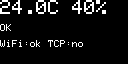

# esp32-monitoring-node

[](https://github.com/poberezhnyipavlo/esp32-monitoring-node/actions/workflows/ci.yml)

ESP32 monitoring node: temperature and humidity (DHT11) sent over TCP in
[`metric-protocol`](https://github.com/poberezhnyipavlo/metric-protocol) v2.1, with an RGB status LED
and an OLED display.
Evolved from [esp32-lab](https://github.com/poberezhnyipavlo/esp32-lab) (stages 07 and 13).

## Metrics

Every 2 s, one sample becomes four lines (names and values from `metric_protocol/MetricNames.h`):

| Name | Value |
|---|---|
| `temperature_c` | °C |
| `humidity_pct` | %RH |
| `temp_alert` | `-1` too cold / `0` normal / `1` too hot (18…27 °C, 0.5 °C hysteresis) |
| `dht_ok` | `1` |

When the sensor does not answer, only `dht_ok` = `0` is sent, so the receiver can tell
"sensor dead" (`dht_ok=0` keeps coming) from "node or network down" (nothing comes).

Samples wait in a queue while the network or the receiver is down and are sent oldest first with their
age (`age_ms`). The queue holds 1000 lines — about 8 minutes without a connection; after that the oldest
are dropped.

> Status: 14.5 — black box: node events on a second channel, watchdog, reset reason and breadcrumbs.

## Logs (black box)

Node events go to a second TCP port (9003), separate from metrics: metrics are numbers for charts,
logs are rare text events for a person. Each event is one line:

```
ver=1 dev=20:9b:a9:61:15:6c boot=e1ff8983 seq=0 age_ms=2843 level=error src=boot text=started, reason=task_watchdog boot=2
```

| Field | Meaning |
|---|---|
| `boot` | random id of this run, the same as in metrics |
| `seq` | order of events within one run, from 0 |
| `age_ms` | how long the event waited in the queue before sending |
| `level` | `info` / `warn` / `error` |
| `src` | who reports: `boot`, `dht` |
| `text` | free text, the rest of the line |

Events:

| `src` | `text` | When |
|---|---|---|
| `boot` | `started, reason=<reason> boot=<n>` | every start; `error` after a crash (`panic`, `task_watchdog`, `brownout`, …) |
| `boot` | `previous boot ended at loop=<step> net=<step> ui=<step>` | after a reset that kept RTC memory: what each task was waiting for |
| `dht` | `sensor stopped answering` (`warn`) | no reading for more than 10 s, once per outage |
| `dht` | `sensor answers again after <n> s` | the first reading after an outage |

How the node protects itself:

- **Task watchdog.** The `loop`, `net` and `ui` tasks must report every 15 s, otherwise the node restarts.
  15 s is above the longest legitimate wait: two TCP connects of 3 s each.
- **Breadcrumbs.** Before a call that can block (TCP connect or send, DHT read, OLED draw) a task writes
  its step into RTC memory, which survives a reset but not a power loss. A magic number tells real data
  from garbage after power on. A watchdog backtrace only shows what the CPU was doing (usually the idle
  task), the breadcrumbs show where the hung task was.
- **Boot counter.** `boot=<n>` counts starts since power on: `boot=3` means the node restarted itself twice.

Receive logs on the computer:

```bash
socat -u TCP-LISTEN:9003,reuseaddr,fork STDOUT
```

`nc -lk 9003` is not enough: after the board resets, the old connection stays half-open, `nc` keeps
serving it, and the first lines of the new run are lost.

## Hardware

| Part | Pin | Notes |
|---|---|---|
| DHT11 module (KY-015) | `S` → D4, middle → 3V3, `−` → GND | |
| RGB LED, common cathode | R → D18, G → D19, B → D23, common → GND | 220 Ω resistor on each colour; HIGH = on |

One resistor per colour, not one on the common leg: red needs ~2 V and green/blue ~3 V, so with a
shared resistor red would take almost all the current whenever two colours are on.

### Status LED

Highest priority first:

| Colour | Meaning |
|---|---|
| red, steady | sensor not working (no successful reading for 10 s) |
| blue | starting, no reading yet |
| red, blinking | temperature out of range (18…27 °C, 0.5 °C hysteresis) |
| yellow | no Wi-Fi or no receiver |
| green | all good |

A dead sensor beats a temperature alert: the last known level is stale, so blinking "too hot" would
be a lie. Yellow is red + green; with plain on/off it looks yellow-green (the green die is brighter).

### Display



  24.3C 41%          climate, last known values (large text)
  OK                 OK / STARTING / TOO HOT / TOO COLD / SENSOR FAIL 12s
  WiFi:ok TCP:no     network

What to show is decided by `buildScreen()` in `lib/Screen` (pure function, unit-tested on the host);
the `Oled` driver only draws it. The screen is rebuilt every 250 ms but sent over I2C only when the
text changes, so the `SENSOR FAIL` counter redraws once a second and a steady screen not at all.
The node runs without a display: if nothing answers on 0x3C/0x3D the log says `[app] oled not found`.

The screenshot is from Wokwi, where no receiver listens, hence `TCP:no`.

## Run locally

```bash
python3 -m venv .venv && source .venv/bin/activate
pip install -r requirements-dev.txt          # pinned clang-format, clang-tidy, PlatformIO

pio test -e native                           # 114 unit tests on the host
scripts/format.sh                            # check formatting (--fix to rewrite)
scripts/tidy.sh                              # static analysis of lib/ and test/

cp include/secrets.example.h include/secrets.h   # then fill in Wi-Fi and receiver
pio run                                      # firmware for the board
pio run -e faults -t upload -t monitor       # firmware that crashes on purpose, see below

pio run -e wokwi && wokwi-cli --timeout 45000 --scenario test.scenario.yaml   # needs WOKWI_CLI_TOKEN
```
### Fault injection

The `faults` env adds Serial commands that break the node on purpose, to check the black box.
The code is behind `#ifdef FAULT_INJECTION`, so the normal firmware does not contain it.
Type a command in the serial monitor and press Enter:

| Command | Expected |
|---|---|
| `panic` | `abort()`, decoded backtrace, then `reason=panic` |
| `hang loop` / `hang net` / `hang ui` | the task is suspended; in 15 s the watchdog names it and restarts the node, `reason=task_watchdog` |

`hang` uses `vTaskSuspend`, so it tests the watchdog, not a real hang inside a call:
the breadcrumbs usually show `idle`.

## CI

Five jobs on every push to `main` and every pull request (documentation-only changes are skipped):

| Job | What it checks | Catches |
|---|---|---|
| test | 114 unit tests on Ubuntu (libstdc++) | logic bugs; includes that only work with libc++ on macOS |
| format | clang-format 21.1.8 | style drift |
| tidy | clang-tidy 21.1.6 on `lib/` and `test/` | bug-prone code, naming, magic numbers, missing includes |
| build | `esp32dev` and `wokwi` firmware builds | firmware that does not compile |
| wokwi | Wokwi scenario on the built firmware | firmware that does not start, stops sampling, or ignores a sensor fault |

Every job was proven to fail on purpose (a deliberately broken pull request: one failing test,
one unformatted line, one magic number, one missing secret, one wrong scenario line).

Caching `~/.platformio` cut the `build` job from 3 min 31 s (cold) to about 1.5 min.
Every job has a 15-minute limit, so a test stuck in an endless loop cannot burn the default 6 hours.

**Not covered by CI:** `src/` (Arduino code) is not analysed by clang-tidy, only compiled;
real hardware is tested manually.

### Wokwi scenario

`test.scenario.yaml` runs on the `wokwi` build (DHT22, Wokwi-GUEST): start, Wi-Fi,
a failed TCP connect and a retry (nobody listens on the gateway), DHT readings,
then a sensor fault and recovery.

At the blue, red and yellow states the scenario also checks the RGB pins (`expect-pin` on 18/19/23),
so swapped colour pins in the firmware fail the run.

The scenario also waits for `[app] oled found`; `diagram.json` has a `board-ssd1306` on 21/22.

**Simulated sensor fault.** Wokwi's DHT22 has no scenario controls and a wire cannot be removed
from a running simulation, so `diagram.json` has an extra push button `btn_dht` between the DHT
data line and GND. Released, the circuit matches the real board; pressed (by the scenario), the
data line is held low, the sensor stops answering and the firmware must log `[app] dht read failed`
and keep sampling. This button does not exist on the real hardware.

## Code style

Google C++ Style Guide, enforced by clang-format and clang-tidy, with two deliberate deviations
to match the Arduino ecosystem:

- functions and methods are `camelCase` (`begin()`, `popFront()`), like the Arduino API;
- files are named after the class (`RingBuffer.h`), like `WiFi.h` and `HardwareSerial.h`.

Indentation is 4 spaces; arguments that do not fit go one per line.

## Pinned versions

| Tool | Version |
|---|---|
| pioarduino platform | 55.03.312-1 (Arduino core 3.3.12, ESP-IDF 5.5.5) |
| PlatformIO | 6.2.0 |
| clang-format / clang-tidy | 21.1.8 / 21.1.6 |
| wokwi-cli | 0.27.1 |
| Adafruit DHT sensor library | 1.4.7 |
| GitHub runner | ubuntu-24.04 |
| Adafruit SSD1306 / GFX / BusIO | 2.5.17 / 1.12.6 / 1.17.4 |

## Sizes

`esp32dev`: Flash 972 244 bytes (74.2 %), RAM 77 504 bytes (23.7 %), RTC memory 12 bytes (breadcrumbs).
The OLED libraries add about 44 KB of flash.
Stack of the `ui` task: 6144 bytes, at least 3836 left free on hardware (with 4096 only 1932 were left,
too close to the canary after drawing was added).
